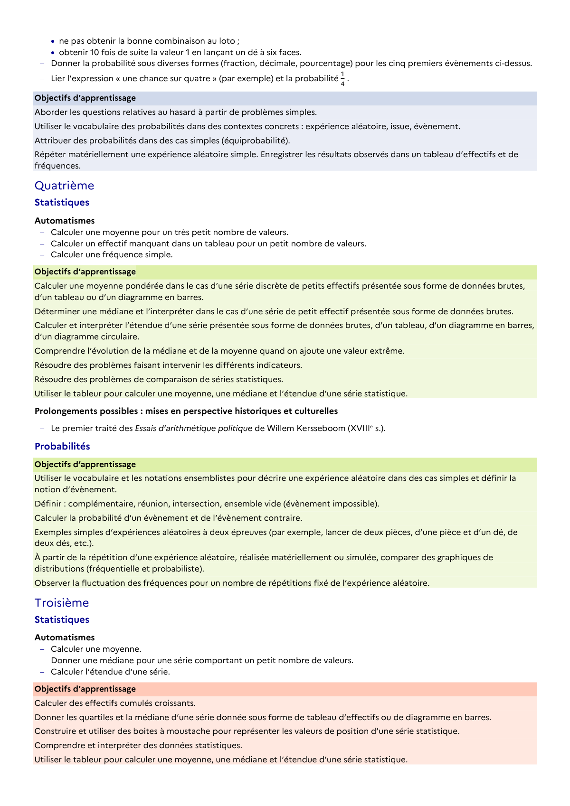

# Donner les quartiles et la médiane d’une série donnée sous forme de tableau d’effectifs ou de diagramme en barres.

## Formulation BO (citation exacte)

> Donner les quartiles et la médiane d’une série donnée sous forme de tableau d’effectifs ou de diagramme en barres.

## Source

Programme officiel : *cycle4.pdf*, **BO n°10 du 5 mars 2026**, page **17**.

---

*Compétence extraite automatiquement le 2026-05-21T20:18:35+00:00. Confiance : 0.9. Statut : non vérifié.*
