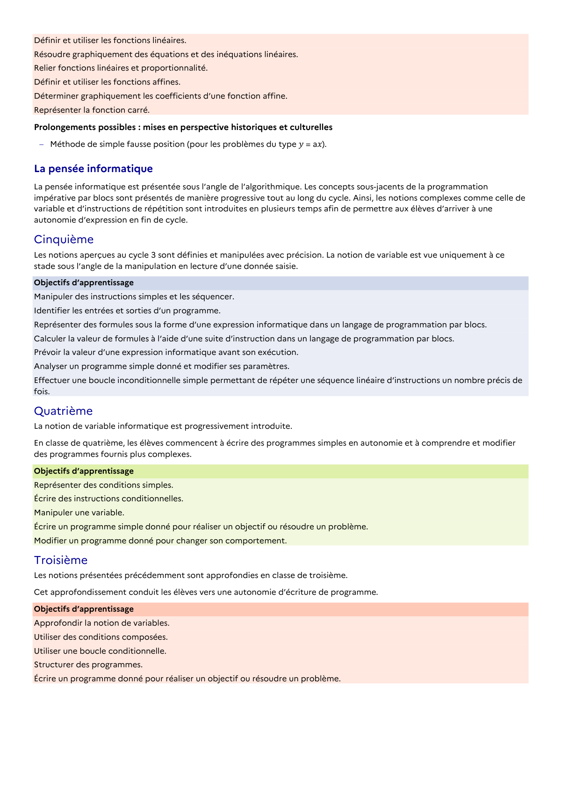

# Modifier un programme donné pour changer son comportement.

## Formulation BO (citation exacte)

> Modifier un programme donné pour changer son comportement.

## Source

Programme officiel : *cycle4.pdf*, **BO n°10 du 5 mars 2026**, page **20**.

---

*Compétence extraite automatiquement le 2026-05-21T20:18:35+00:00. Confiance : 0.9. Statut : non vérifié.*
