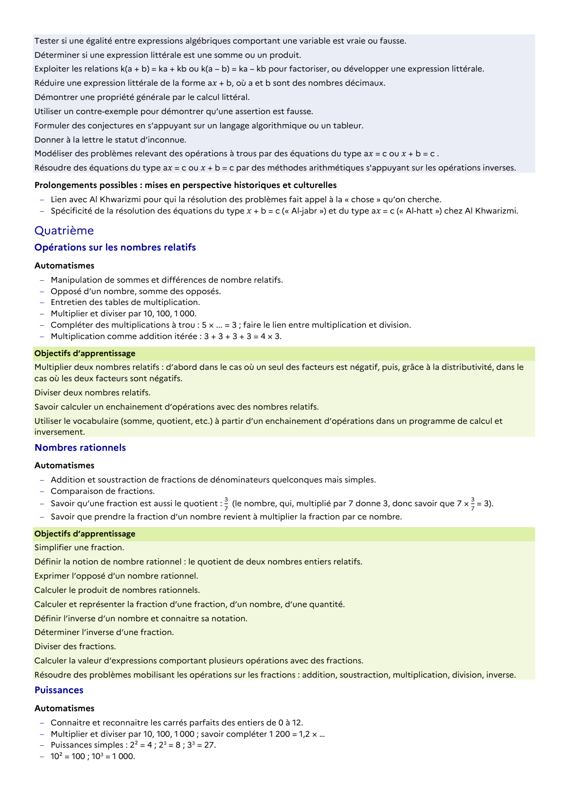

# Multiplier deux nombres relatifs : d’abord dans le cas où un seul des facteurs est négatif, puis, grâce à la distributivité, dans le cas où les deux facteurs sont négatifs.

## Formulation BO (citation exacte)

> Multiplier deux nombres relatifs : d’abord dans le cas où un seul des facteurs est négatif, puis, grâce à la distributivité, dans le cas où les deux facteurs sont négatifs.

## Source

Programme officiel : *cycle4.pdf*, **BO n°10 du 5 mars 2026**, page **9**.

---

*Compétence extraite automatiquement le 2026-05-21T20:18:35+00:00. Confiance : 0.9. Statut : non vérifié.*
