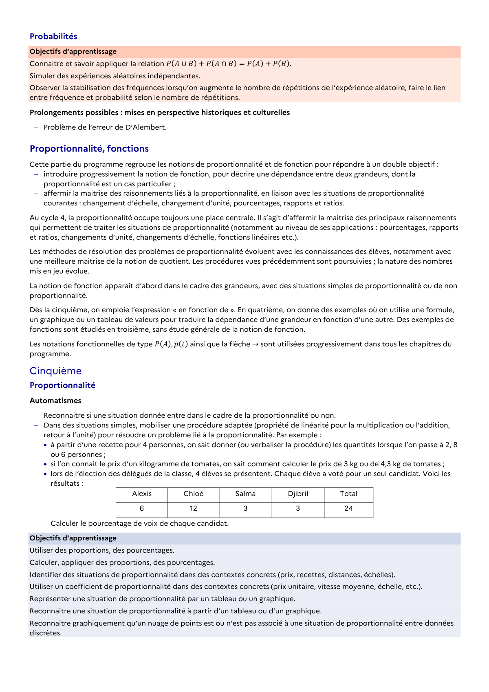

# Utiliser un coefficient de proportionnalité dans des contextes concrets (prix unitaire, vitesse moyenne, échelle, etc.).

## Formulation BO (citation exacte)

> Utiliser un coefficient de proportionnalité dans des contextes concrets (prix unitaire, vitesse moyenne, échelle, etc.).

## Source

Programme officiel : *cycle4.pdf*, **BO n°10 du 5 mars 2026**, page **18**.

---

*Compétence extraite automatiquement le 2026-05-21T20:18:35+00:00. Confiance : 0.9. Statut : non vérifié.*
