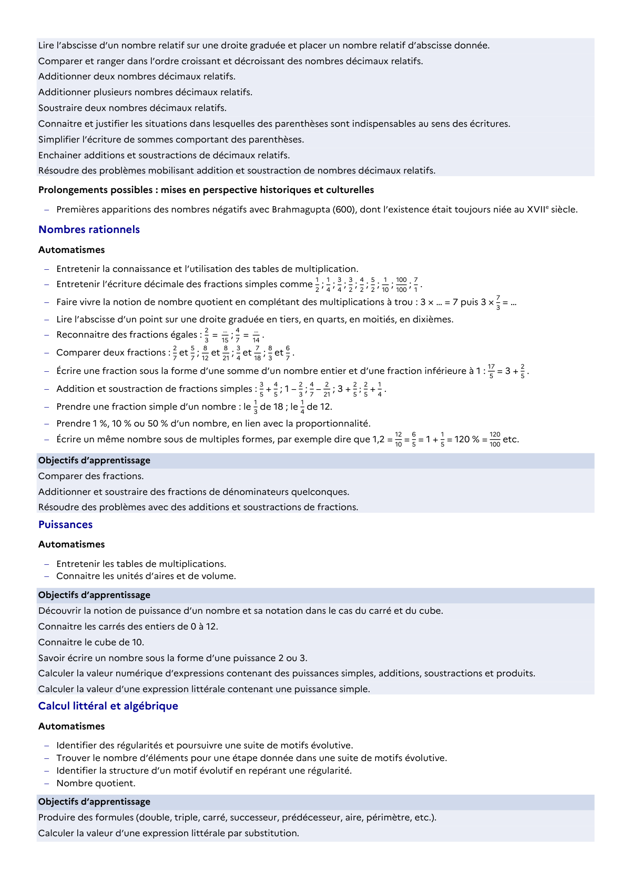

# Lire l'abscisse d'un nombre relatif sur une droite graduée et placer un nombre relatif d'abscisse donnée.

## Formulation BO (citation exacte)

> Lire l'abscisse d'un nombre relatif sur une droite graduée et placer un nombre relatif d'abscisse donnée.

## Source

Programme officiel : *cycle4.pdf*, **BO n°10 du 5 mars 2026**, page **8**.

---

*Compétence extraite automatiquement le 2026-05-25T00:00:00+00:00. Confiance : 0.95. Statut : non vérifié.*
