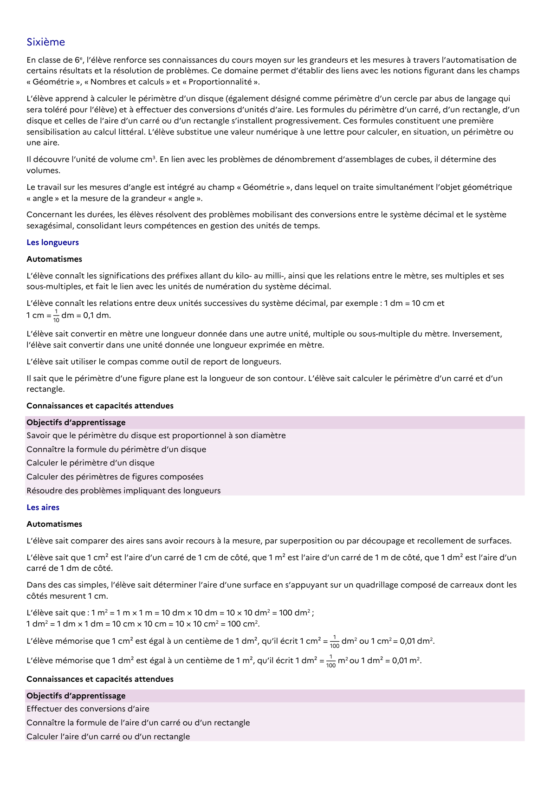

# Connaître la formule du périmètre d’un disque

## Formulation BO (citation exacte)

> Connaître la formule du périmètre d’un disque

## Source

Programme officiel : *cycle3.pdf*, **BO du cycle 3 (rentrée 2026)**, page **19**.

---

*Compétence extraite automatiquement le 2026-05-21T20:18:35+00:00. Confiance : 0.9. Statut : non vérifié.*
