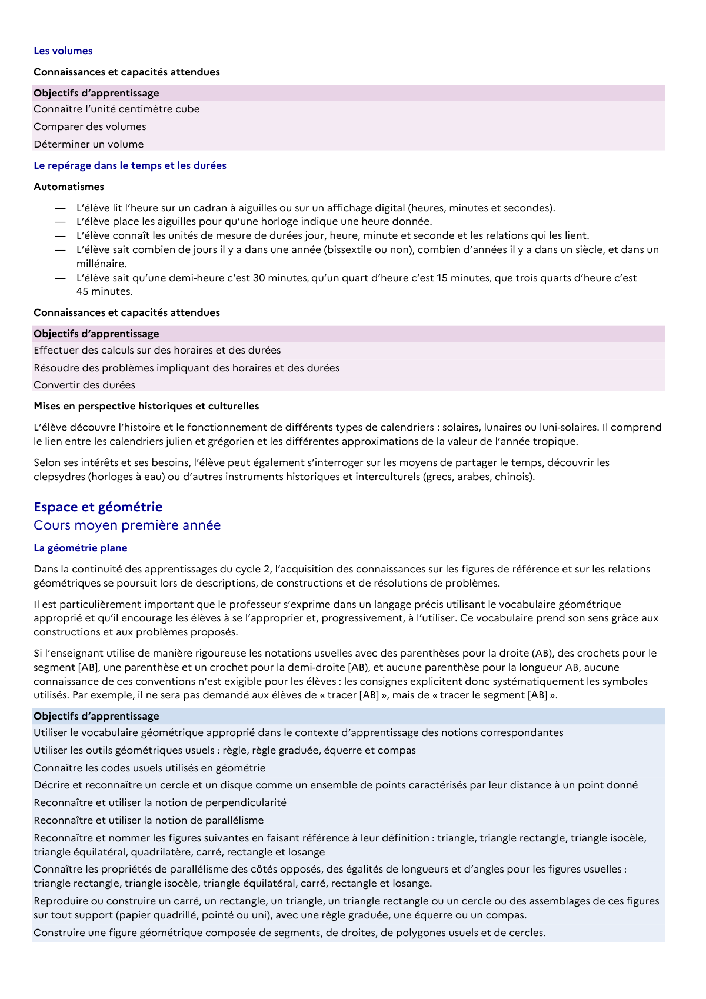

# Connaître les propriétés de parallélisme des côtés opposés, des égalités de longueurs et d’angles pour les figures usuelles : triangle rectangle, triangle isocèle, triangle équilatéral, carré, rectangle et losange.

## Formulation BO (citation exacte)

> Connaître les propriétés de parallélisme des côtés opposés, des égalités de longueurs et d’angles pour les figures usuelles : triangle rectangle, triangle isocèle, triangle équilatéral, carré, rectangle et losange.

## Source

Programme officiel : *cycle3.pdf*, **BO du cycle 3 (rentrée 2026)**, page **20**.

---

*Compétence extraite automatiquement le 2026-05-21T20:18:35+00:00. Confiance : 0.9. Statut : non vérifié.*
