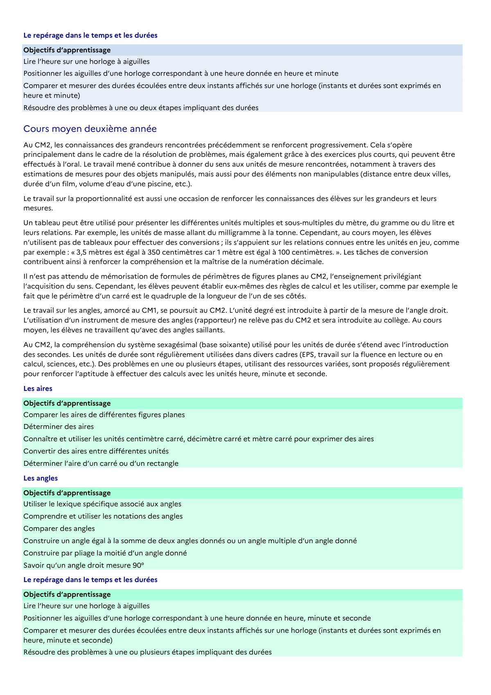

# Lire l’heure sur une horloge à aiguilles

## Formulation BO (citation exacte)

> Lire l’heure sur une horloge à aiguilles

## Source

Programme officiel : *cycle3.pdf*, **BO du cycle 3 (rentrée 2026)**, page **18**.

---

*Compétence extraite automatiquement le 2026-05-21T20:18:35+00:00. Confiance : 0.9. Statut : non vérifié.*
