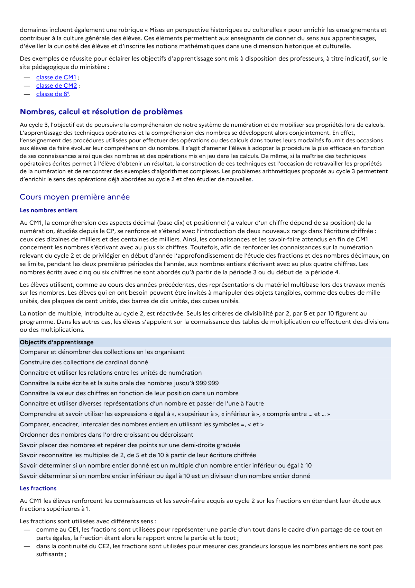

# Connaître la suite écrite et la suite orale des nombres jusqu’à 999 999

## Formulation BO (citation exacte)

> Connaître la suite écrite et la suite orale des nombres jusqu’à 999 999

## Source

Programme officiel : *cycle3.pdf*, **BO du cycle 3 (rentrée 2026)**, page **5**.

---

*Compétence extraite automatiquement le 2026-05-21T20:18:35+00:00. Confiance : 0.9. Statut : non vérifié.*
