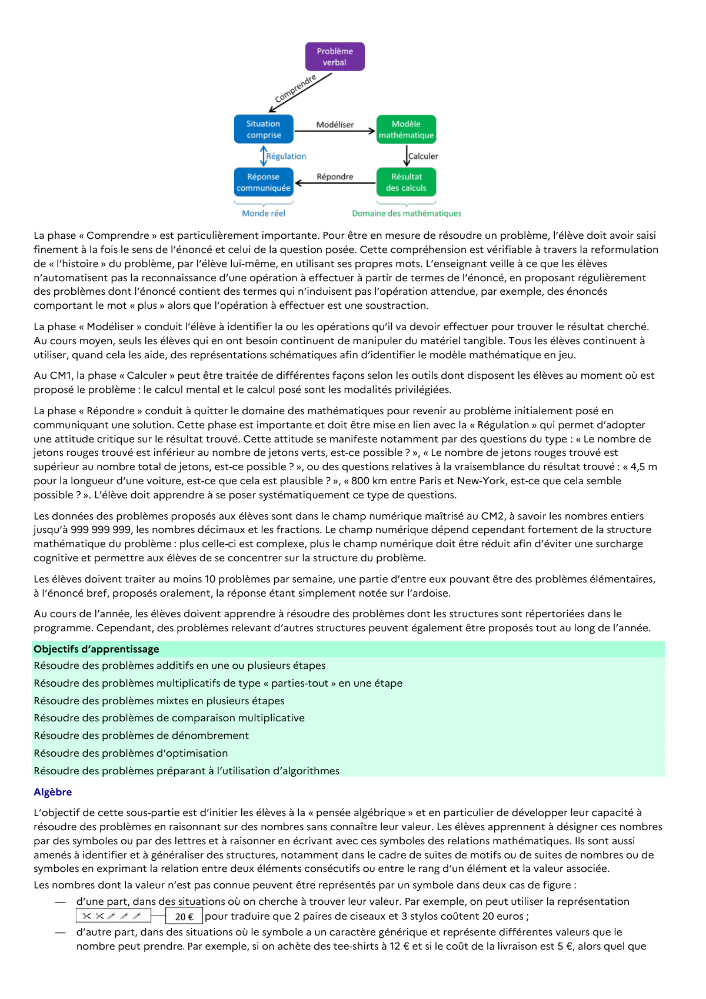

# d’autre part, dans des situations où le symbole a un caractère générique et représente différentes valeurs que le

## Formulation BO (citation exacte)

> d’autre part, dans des situations où le symbole a un caractère générique et représente différentes valeurs que le

## Source

Programme officiel : *cycle3.pdf*, **BO du cycle 3 (rentrée 2026)**, page **12**.

---

*Compétence extraite automatiquement le 2026-05-21T20:18:35+00:00. Confiance : 0.9. Statut : non vérifié.*
