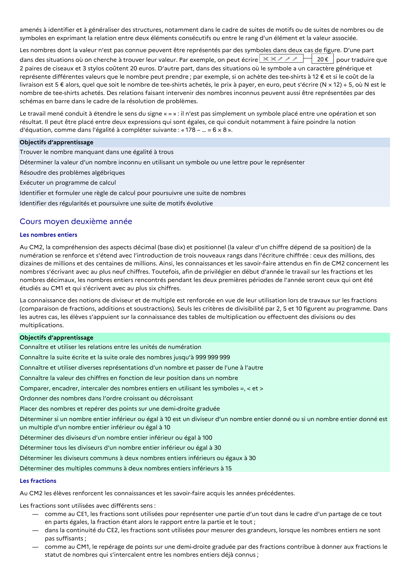

# comme au CE1, les fractions sont utilisées pour représenter une partie d’un tout dans le cadre d’un partage de ce tout

## Formulation BO (citation exacte)

> comme au CE1, les fractions sont utilisées pour représenter une partie d’un tout dans le cadre d’un partage de ce tout

## Source

Programme officiel : *cycle3.pdf*, **BO du cycle 3 (rentrée 2026)**, page **9**.

---

*Compétence extraite automatiquement le 2026-05-21T20:18:35+00:00. Confiance : 0.9. Statut : non vérifié.*
