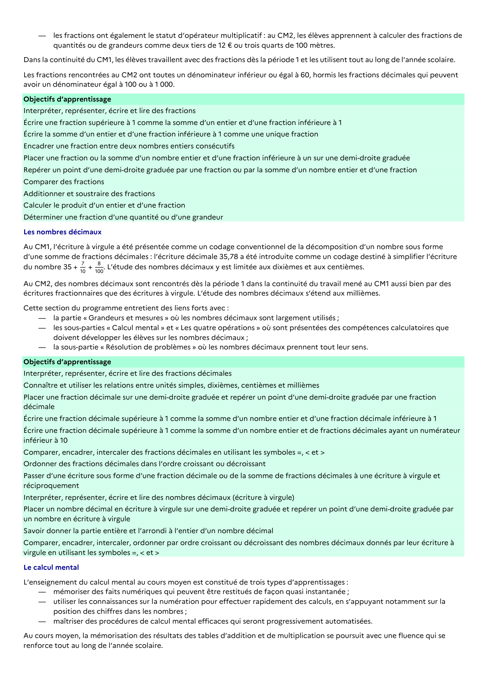

# Placer un nombre décimal en écriture à virgule sur une demi-droite graduée et repérer un point d’une demi-droite graduée par un nombre en écriture à virgule

## Formulation BO (citation exacte)

> Placer un nombre décimal en écriture à virgule sur une demi-droite graduée et repérer un point d’une demi-droite graduée par un nombre en écriture à virgule

## Source

Programme officiel : *cycle3.pdf*, **BO du cycle 3 (rentrée 2026)**, page **10**.

---

*Compétence extraite automatiquement le 2026-05-21T20:18:35+00:00. Confiance : 0.9. Statut : non vérifié.*
