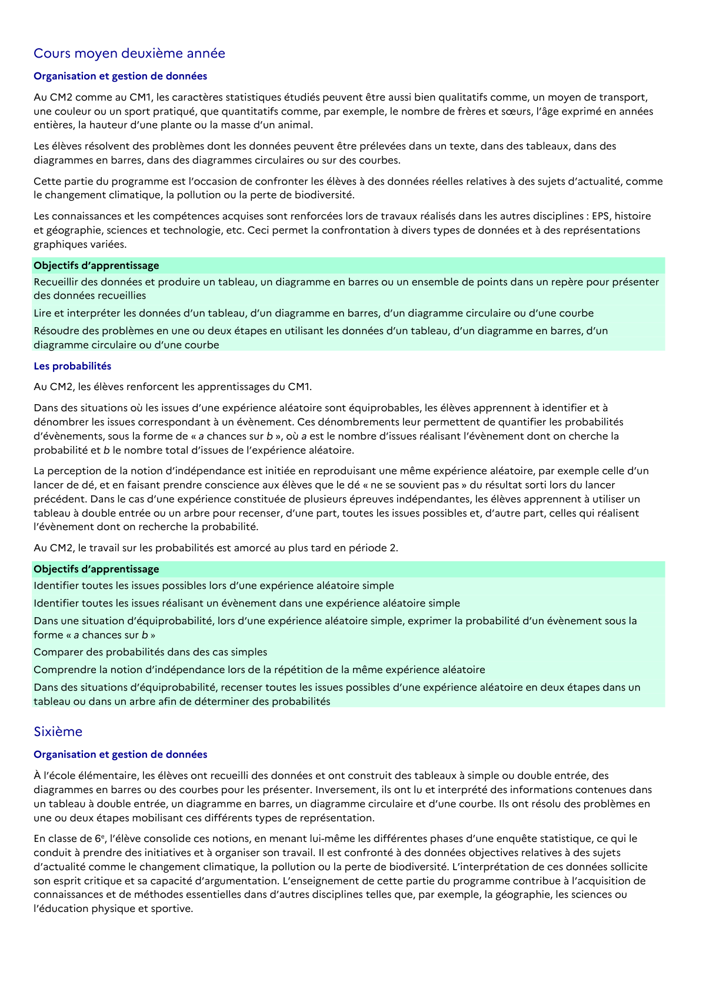

# Lire et interpréter les données d’un tableau, d’un diagramme en barres, d’un diagramme circulaire ou d’une courbe

## Formulation BO (citation exacte)

> Lire et interpréter les données d’un tableau, d’un diagramme en barres, d’un diagramme circulaire ou d’une courbe

## Source

Programme officiel : *cycle3.pdf*, **BO du cycle 3 (rentrée 2026)**, page **25**.

---

*Compétence extraite automatiquement le 2026-05-21T20:18:35+00:00. Confiance : 0.9. Statut : non vérifié.*
