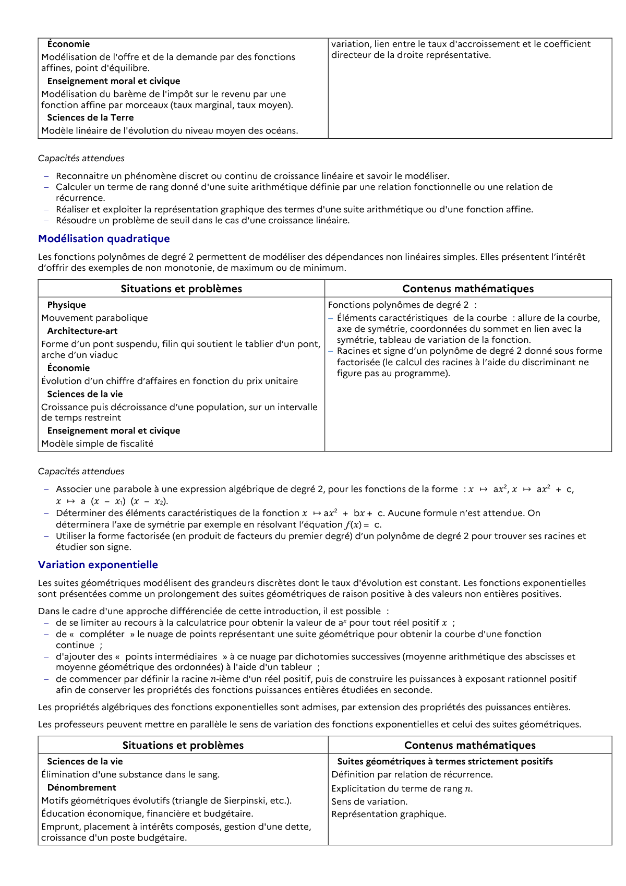

# de se limiter au recours à la calculatrice pour obtenir la valeur de a𝑥 pour tout réel positif 𝑥 ;

## Formulation BO (citation exacte)

> de se limiter au recours à la calculatrice pour obtenir la valeur de a𝑥 pour tout réel positif 𝑥 ;

## Source

Programme officiel : *1ens.pdf*, **BO Hebdo 14 du 2 avril 2026**, page **6**.

---

*Compétence extraite automatiquement le 2026-05-21T20:18:35+00:00. Confiance : 0.9. Statut : non vérifié.*
