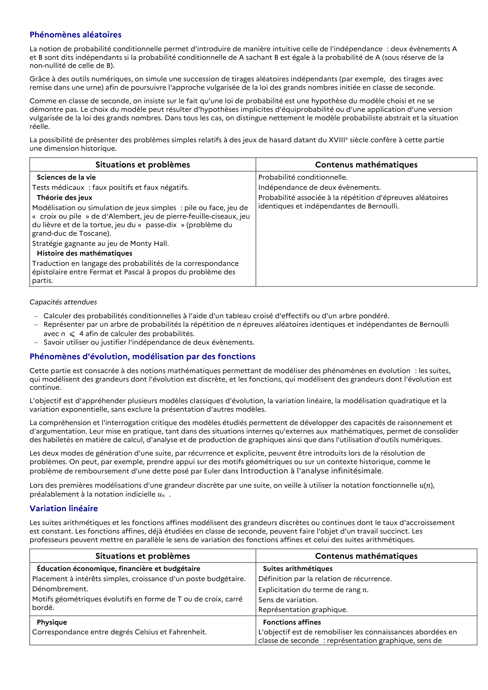

# Calculer des probabilités conditionnelles à l'aide d'un tableau croisé d'effectifs ou d'un arbre pondéré.

## Formulation BO (citation exacte)

> Calculer des probabilités conditionnelles à l'aide d'un tableau croisé d'effectifs ou d'un arbre pondéré.

## Source

Programme officiel : *1ens.pdf*, **BO Hebdo 14 du 2 avril 2026**, page **5**.

---

*Compétence extraite automatiquement le 2026-05-21T20:18:35+00:00. Confiance : 0.9. Statut : non vérifié.*
