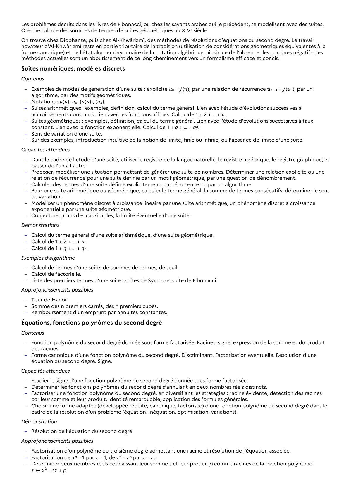

# Proposer, modéliser une situation permettant de générer une suite de nombres. Déterminer une relation explicite ou une relation de récurrence pour une suite définie par un motif géométrique, par une question de dénombrement.

## Formulation BO (citation exacte)

> Proposer, modéliser une situation permettant de générer une suite de nombres. Déterminer une relation explicite ou une relation de récurrence pour une suite définie par un motif géométrique, par une question de dénombrement.

## Source

Programme officiel : *1spe.pdf*, **BO Hebdo 14 du 2 avril 2026**, page **6**.

---

*Compétence extraite automatiquement le 2026-05-21T20:18:35+00:00. Confiance : 0.9. Statut : non vérifié.*
