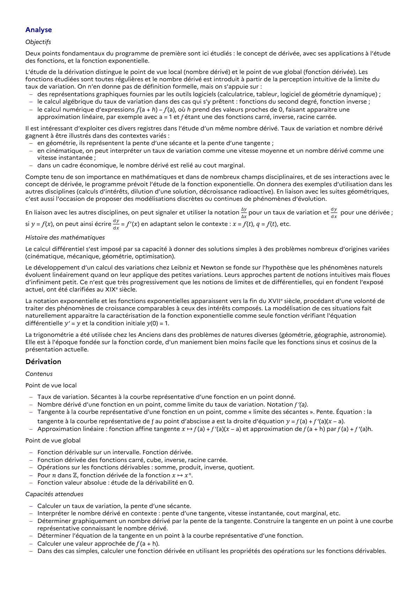

# Approximation linéaire : fonction affine tangente 𝑥 ↦ ƒ (a) + ƒ ‘(a)(𝑥 – a) et approximation de ƒ (a + h) par ƒ (a) + ƒ ‘(a)h.

## Formulation BO (citation exacte)

> Approximation linéaire : fonction affine tangente 𝑥 ↦ ƒ (a) + ƒ ‘(a)(𝑥 – a) et approximation de ƒ (a + h) par ƒ (a) + ƒ ‘(a)h.

## Source

Programme officiel : *1spe.pdf*, **BO Hebdo 14 du 2 avril 2026**, page **7**.

---

*Compétence extraite automatiquement le 2026-05-21T20:18:35+00:00. Confiance : 0.9. Statut : non vérifié.*
