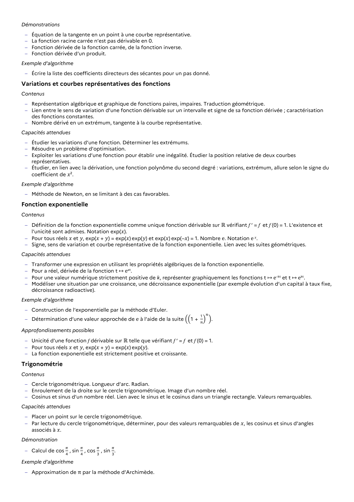

# Détermination d’une valeur approchée de e à l’aide de la suite ((1 + 1 𝑛) 𝑛 ).

## Formulation BO (citation exacte)

> Détermination d’une valeur approchée de e à l’aide de la suite ((1 + 1 𝑛) 𝑛 ).

## Source

Programme officiel : *1spe.pdf*, **BO Hebdo 14 du 2 avril 2026**, page **8**.

---

*Compétence extraite automatiquement le 2026-05-21T20:18:35+00:00. Confiance : 0.9. Statut : non vérifié.*
