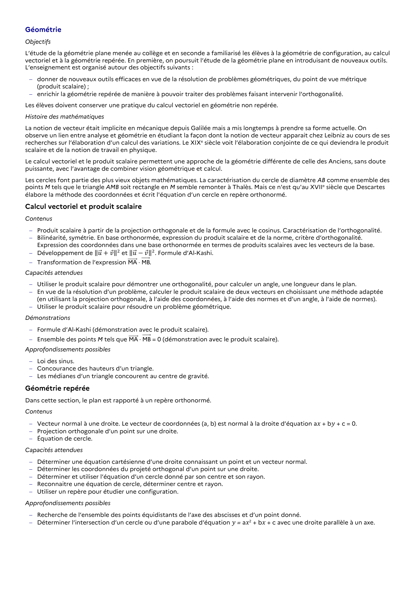

# Déterminer l’intersection d’un cercle ou d’une parabole d’équation 𝑦 = a𝑥2 + b𝑥 + c avec une droite parallèle à un axe.

## Formulation BO (citation exacte)

> Déterminer l’intersection d’un cercle ou d’une parabole d’équation 𝑦 = a𝑥2 + b𝑥 + c avec une droite parallèle à un axe.

## Source

Programme officiel : *1spe.pdf*, **BO Hebdo 14 du 2 avril 2026**, page **9**.

---

*Compétence extraite automatiquement le 2026-05-21T20:18:35+00:00. Confiance : 0.9. Statut : non vérifié.*
