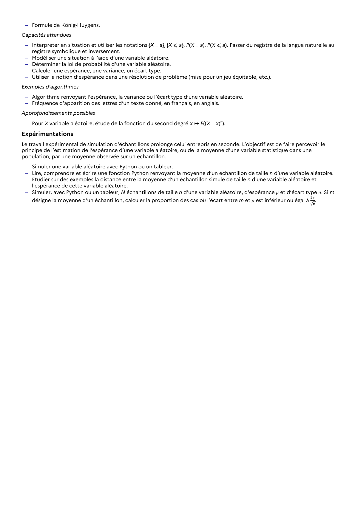

# Utiliser la notion d’espérance dans une résolution de problème (mise pour un jeu équitable, etc.).

## Formulation BO (citation exacte)

> Utiliser la notion d’espérance dans une résolution de problème (mise pour un jeu équitable, etc.).

## Source

Programme officiel : *1spe.pdf*, **BO Hebdo 14 du 2 avril 2026**, page **11**.

---

*Compétence extraite automatiquement le 2026-05-21T20:18:35+00:00. Confiance : 0.9. Statut : non vérifié.*
