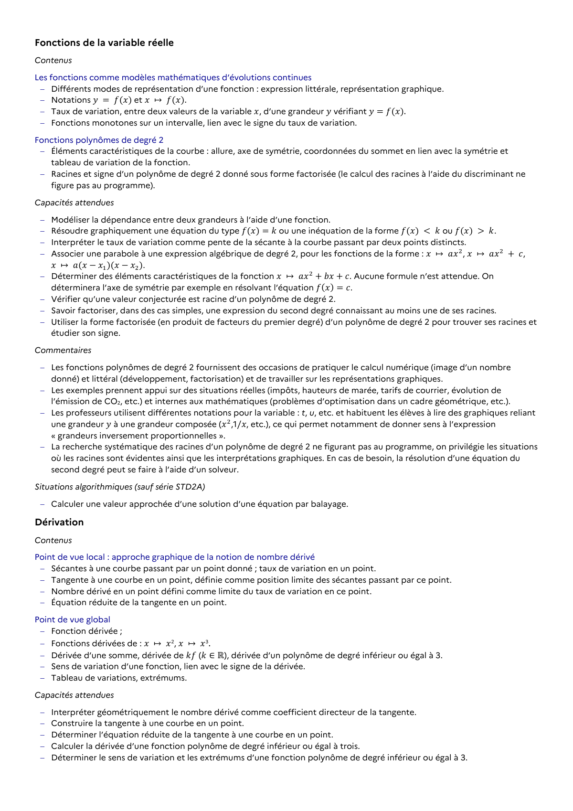

# Notations 𝑦 =  𝑓(𝑥) et 𝑥 ↦  𝑓(𝑥).

## Formulation BO (citation exacte)

> Notations 𝑦 =  𝑓(𝑥) et 𝑥 ↦  𝑓(𝑥).

## Source

Programme officiel : *1tec.pdf*, **BO Hebdo 14 du 2 avril 2026**, page **8**.

---

*Compétence extraite automatiquement le 2026-05-21T20:18:35+00:00. Confiance : 0.9. Statut : non vérifié.*
