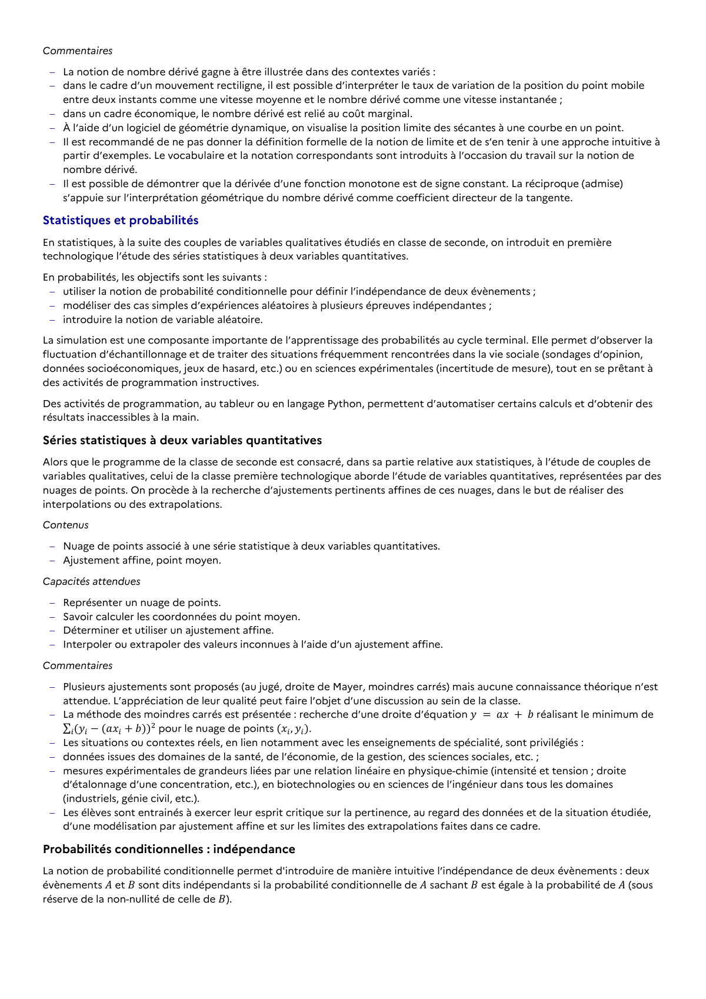

# À l’aide d’un logiciel de géométrie dynamique, on visualise la position limite des sécantes à une courbe en un point.

## Formulation BO (citation exacte)

> À l’aide d’un logiciel de géométrie dynamique, on visualise la position limite des sécantes à une courbe en un point.

## Source

Programme officiel : *1tec.pdf*, **BO Hebdo 14 du 2 avril 2026**, page **9**.

---

*Compétence extraite automatiquement le 2026-05-21T20:18:35+00:00. Confiance : 0.9. Statut : non vérifié.*
