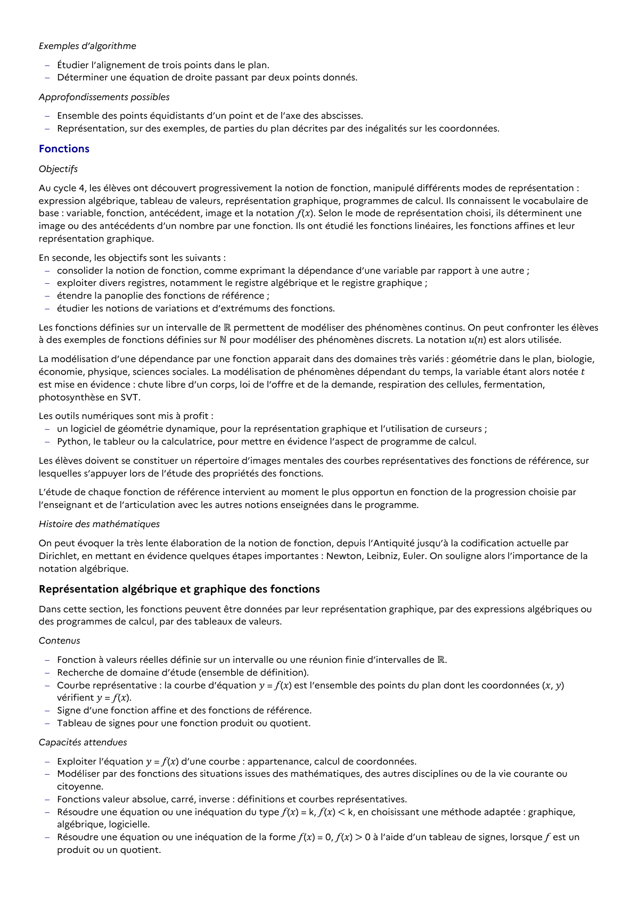

# Python, le tableur ou la calculatrice, pour mettre en évidence l’aspect de programme de calcul. Les élèves doivent se constituer un répertoire d’images mentales des courbes représentatives des fonctions de référence, sur lesquelles s’appuyer lors de l’étude des propriétés des fonctions. L’étude de chaque fonction de référence intervient au moment le plus opportun en fonction de la progression choisie par l’enseignant et de l’articulation avec les autres notions enseignées dans le programme.

## Formulation BO (citation exacte)

> Python, le tableur ou la calculatrice, pour mettre en évidence l’aspect de programme de calcul. Les élèves doivent se constituer un répertoire d’images mentales des courbes représentatives des fonctions de référence, sur lesquelles s’appuyer lors de l’étude des propriétés des fonctions. L’étude de chaque fonction de référence intervient au moment le plus opportun en fonction de la progression choisie par l’enseignant et de l’articulation avec les autres notions enseignées dans le programme.

## Source

Programme officiel : *2gt.pdf*, **BO Hebdo 14 du 2 avril 2026**, page **10**.

---

*Compétence extraite automatiquement le 2026-05-21T20:18:35+00:00. Confiance : 0.9. Statut : non vérifié.*
