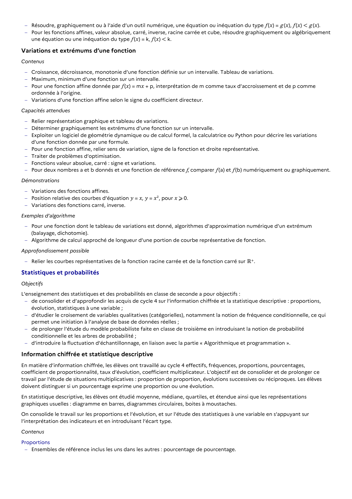

# Pour une fonction affine donnée par ƒ (𝑥) = m𝑥 + p, interprétation de m comme taux d’accroissement et de p comme ordonnée à l’origine.

## Formulation BO (citation exacte)

> Pour une fonction affine donnée par ƒ (𝑥) = m𝑥 + p, interprétation de m comme taux d’accroissement et de p comme ordonnée à l’origine.

## Source

Programme officiel : *2gt.pdf*, **BO Hebdo 14 du 2 avril 2026**, page **11**.

---

*Compétence extraite automatiquement le 2026-05-21T20:18:35+00:00. Confiance : 0.9. Statut : non vérifié.*
