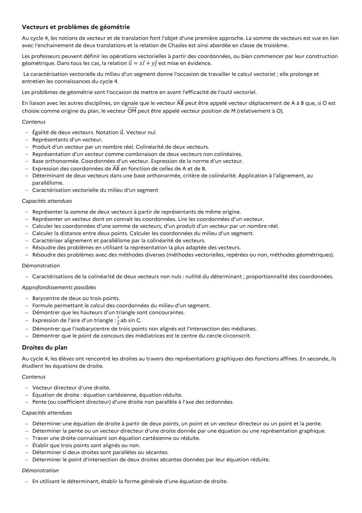

# Démontrer que les hauteurs d’un triangle sont concourantes.

## Formulation BO (citation exacte)

> Démontrer que les hauteurs d’un triangle sont concourantes.

## Source

Programme officiel : *2gt.pdf*, **BO Hebdo 14 du 2 avril 2026**, page **9**.

---

*Compétence extraite automatiquement le 2026-05-21T20:18:35+00:00. Confiance : 0.9. Statut : non vérifié.*
