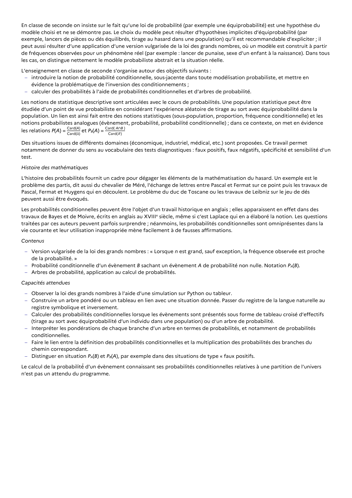

# calculer des probabilités à l’aide de probabilités conditionnelles et d’arbres de probabilité. Les notions de statistique descriptive sont articulées avec le cours de probabilités. Une population statistique peut être étudiée d’un point de vue probabiliste en considérant l’expérience aléatoire de tirage au sort avec équiprobabilité dans la population. Un lien est ainsi fait entre des notions statistiques (sous-population, proportion, fréquence conditionnelle) et les notions probabilistes analogues (évènement, probabilité, probabilité conditionnelle) ; dans ce contexte, on met en évidence les relations P(A) = Card(A) Card(Ω) et PB(A) = Card( A∩B ) Card(B ) Des situations issues de différents domaines (économique, industriel, médical, etc.) sont proposées. Ce travail permet notamment de donner du sens au vocabulaire des tests diagnostiques : faux positifs, faux négatifs, spécificité et sensibilité d’un test.

## Formulation BO (citation exacte)

> calculer des probabilités à l’aide de probabilités conditionnelles et d’arbres de probabilité. Les notions de statistique descriptive sont articulées avec le cours de probabilités. Une population statistique peut être étudiée d’un point de vue probabiliste en considérant l’expérience aléatoire de tirage au sort avec équiprobabilité dans la population. Un lien est ainsi fait entre des notions statistiques (sous-population, proportion, fréquence conditionnelle) et les notions probabilistes analogues (évènement, probabilité, probabilité conditionnelle) ; dans ce contexte, on met en évidence les relations P(A) = Card(A) Card(Ω) et PB(A) = Card( A∩B ) Card(B ) Des situations issues de différents domaines (économique, industriel, médical, etc.) sont proposées. Ce travail permet notamment de donner du sens au vocabulaire des tests diagnostiques : faux positifs, faux négatifs, spécificité et sensibilité d’un test.

## Source

Programme officiel : *2gt.pdf*, **BO Hebdo 14 du 2 avril 2026**, page **13**.

---

*Compétence extraite automatiquement le 2026-05-21T20:18:35+00:00. Confiance : 0.9. Statut : non vérifié.*
