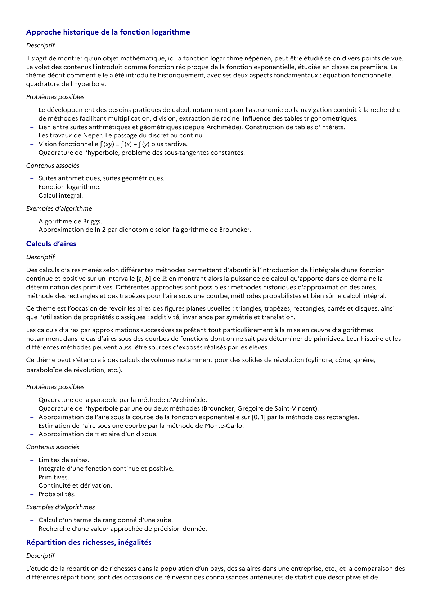

# Approximation de l’aire sous la courbe de la fonction exponentielle sur [0, 1] par la méthode des rectangles.

## Formulation BO (citation exacte)

> Approximation de l’aire sous la courbe de la fonction exponentielle sur [0, 1] par la méthode des rectangles.

## Source

Programme officiel : *tcomp.pdf*, **BO Hebdo 14 du 2 avril 2026**, page **5**.

---

*Compétence extraite automatiquement le 2026-05-21T20:18:35+00:00. Confiance : 0.9. Statut : non vérifié.*
