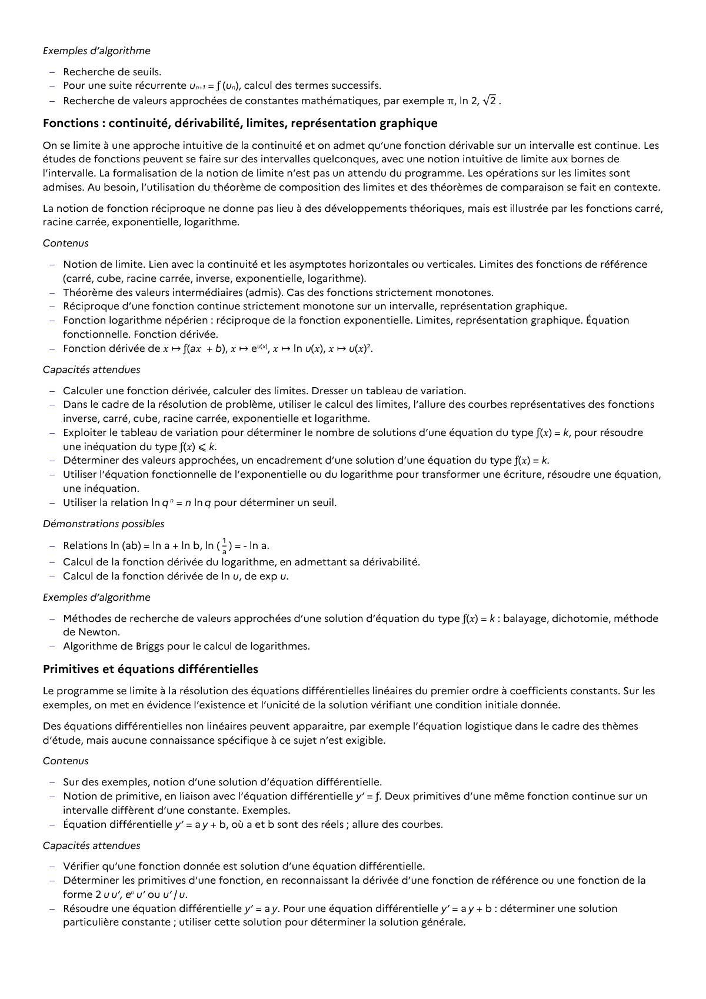

# Résoudre une équation différentielle y’ = a y. Pour une équation différentielle y’ = a y + b : déterminer une solution particulière constante ; utiliser cette solution pour déterminer la solution générale.

## Formulation BO (citation exacte)

> Résoudre une équation différentielle y’ = a y. Pour une équation différentielle y’ = a y + b : déterminer une solution particulière constante ; utiliser cette solution pour déterminer la solution générale.

## Source

Programme officiel : *tcomp.pdf*, **BO Hebdo 14 du 2 avril 2026**, page **9**.

---

*Compétence extraite automatiquement le 2026-05-21T20:18:35+00:00. Confiance : 0.9. Statut : non vérifié.*
