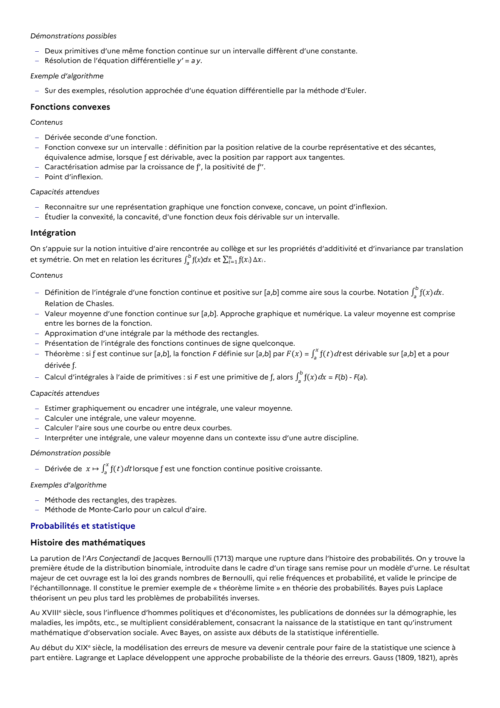

# Fonction convexe sur un intervalle : définition par la position relative de la courbe représentative et des sécantes, équivalence admise, lorsque ƒ est dérivable, avec la position par rapport aux tangentes.

## Formulation BO (citation exacte)

> Fonction convexe sur un intervalle : définition par la position relative de la courbe représentative et des sécantes, équivalence admise, lorsque ƒ est dérivable, avec la position par rapport aux tangentes.

## Source

Programme officiel : *tcomp.pdf*, **BO Hebdo 14 du 2 avril 2026**, page **10**.

---

*Compétence extraite automatiquement le 2026-05-21T20:18:35+00:00. Confiance : 0.9. Statut : non vérifié.*
