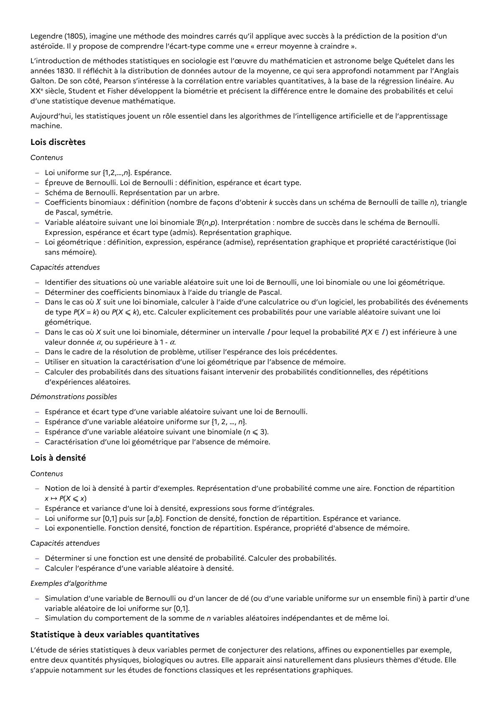

# Simulation du comportement de la somme de n variables aléatoires indépendantes et de même loi. Statistique à deux variables quantitatives L’étude de séries statistiques à deux variables permet de conjecturer des relations, affines ou exponentielles par exemple, entre deux quantités physiques, biologiques ou autres. Elle apparait ainsi naturellement dans plusieurs thèmes d'étude. Elle s’appuie notamment sur les études de fonctions classiques et les représentations graphiques.

## Formulation BO (citation exacte)

> Simulation du comportement de la somme de n variables aléatoires indépendantes et de même loi. Statistique à deux variables quantitatives L’étude de séries statistiques à deux variables permet de conjecturer des relations, affines ou exponentielles par exemple, entre deux quantités physiques, biologiques ou autres. Elle apparait ainsi naturellement dans plusieurs thèmes d'étude. Elle s’appuie notamment sur les études de fonctions classiques et les représentations graphiques.

## Source

Programme officiel : *tcomp.pdf*, **BO Hebdo 14 du 2 avril 2026**, page **11**.

---

*Compétence extraite automatiquement le 2026-05-21T20:18:35+00:00. Confiance : 0.9. Statut : non vérifié.*
