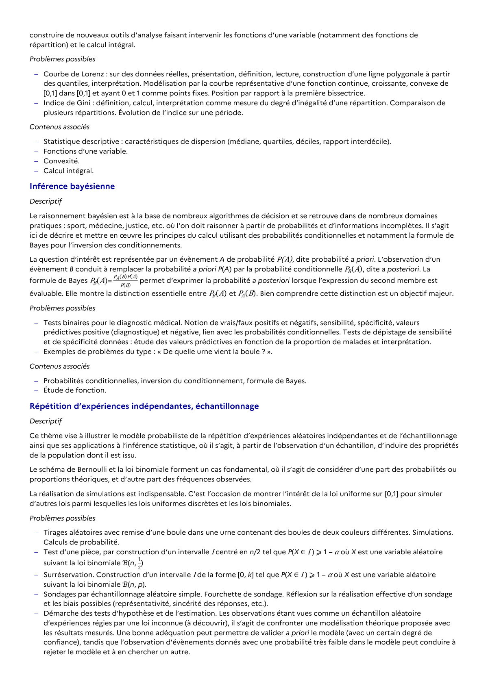

# Courbe de Lorenz : sur des données réelles, présentation, définition, lecture, construction d’une ligne polygonale à partir des quantiles, interprétation. Modélisation par la courbe représentative d’une fonction continue, croissante, convexe de [0,1] dans [0,1] et ayant 0 et 1 comme points fixes. Position par rapport à la première bissectrice.

## Formulation BO (citation exacte)

> Courbe de Lorenz : sur des données réelles, présentation, définition, lecture, construction d’une ligne polygonale à partir des quantiles, interprétation. Modélisation par la courbe représentative d’une fonction continue, croissante, convexe de [0,1] dans [0,1] et ayant 0 et 1 comme points fixes. Position par rapport à la première bissectrice.

## Source

Programme officiel : *tcomp.pdf*, **BO Hebdo 14 du 2 avril 2026**, page **6**.

---

*Compétence extraite automatiquement le 2026-05-21T20:18:35+00:00. Confiance : 0.9. Statut : non vérifié.*
