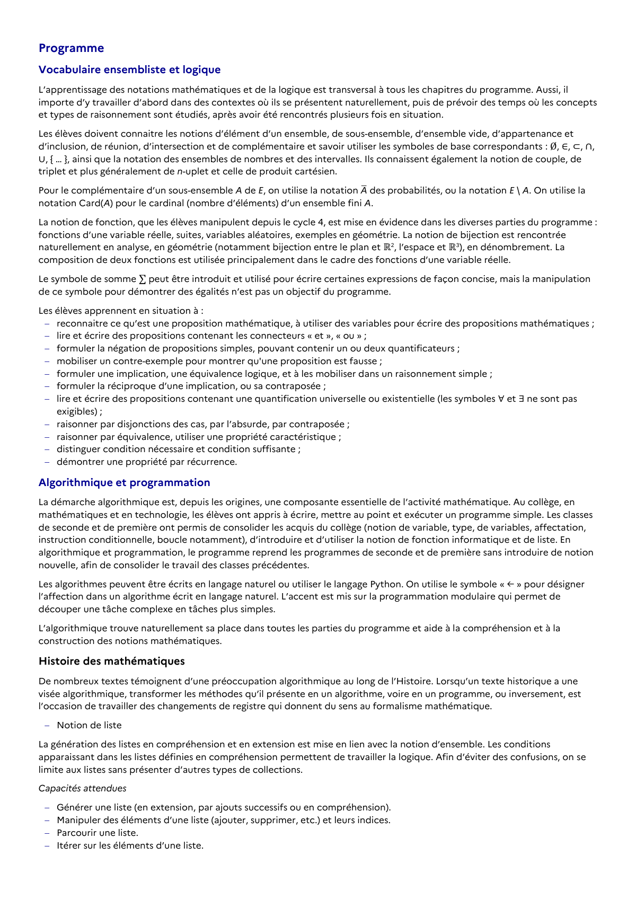

# Générer une liste (en extension, par ajouts successifs ou en compréhension).

## Formulation BO (citation exacte)

> Générer une liste (en extension, par ajouts successifs ou en compréhension).

## Source

Programme officiel : *tspe.pdf*, **BO Hebdo 14 du 2 avril 2026**, page **4**.

---

*Compétence extraite automatiquement le 2026-05-21T20:18:35+00:00. Confiance : 0.7. Statut : non vérifié.*
