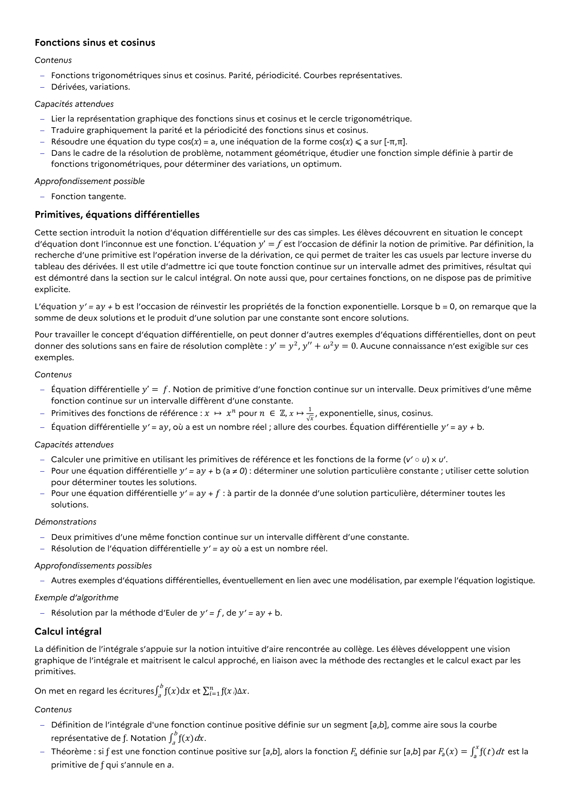

# Deux primitives d’une même fonction continue sur un intervalle diffèrent d’une constante.

## Formulation BO (citation exacte)

> Deux primitives d’une même fonction continue sur un intervalle diffèrent d’une constante.

## Démonstrations exigibles

*(corps de la démonstration à compléter)*

## Source

Programme officiel : *tspe.pdf*, **BO Hebdo 14 du 2 avril 2026**, page **11**.

---

*Compétence extraite automatiquement le 2026-05-21T20:18:35+00:00. Confiance : 0.9. Statut : non vérifié.*
