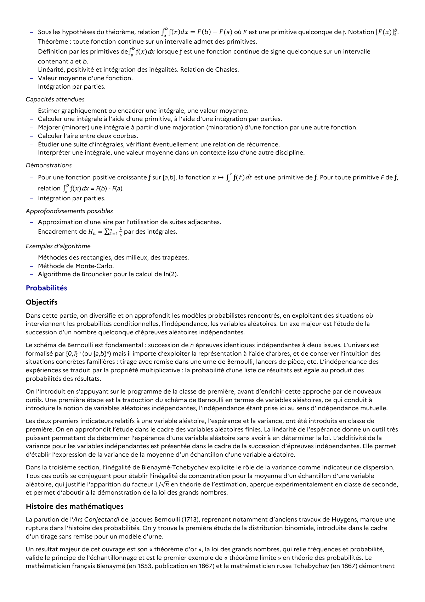

# Sous les hypothèses du théorème, relation ∫ ƒ(𝑥)𝑑𝑥 = 𝐹(b) − 𝐹(a) b a où 𝐹 est une primitive quelconque de ƒ. Notation [𝐹(𝑥)]a b.

## Formulation BO (citation exacte)

> Sous les hypothèses du théorème, relation ∫ ƒ(𝑥)𝑑𝑥 = 𝐹(b) − 𝐹(a) b a où 𝐹 est une primitive quelconque de ƒ. Notation [𝐹(𝑥)]a b.

## Source

Programme officiel : *tspe.pdf*, **BO Hebdo 14 du 2 avril 2026**, page **12**.

---

*Compétence extraite automatiquement le 2026-05-21T20:18:35+00:00. Confiance : 0.9. Statut : non vérifié.*
