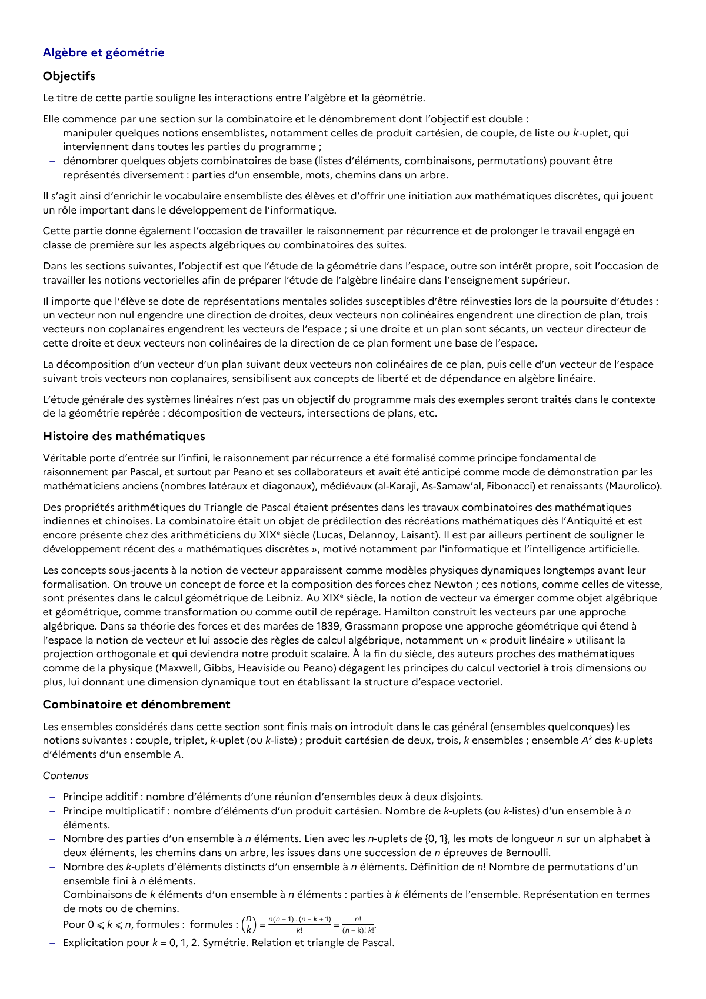

# dénombrer quelques objets combinatoires de base (listes d’éléments, combinaisons, permutations) pouvant être représentés diversement : parties d’un ensemble, mots, chemins dans un arbre. Il s’agit ainsi d’enrichir le vocabulaire ensembliste des élèves et d’offrir une initiation aux mathématiques discrètes, qui jouent un rôle important dans le développement de l’informatique. Cette partie donne également l’occasion de travailler le raisonnement par récurrence et de prolonger le travail engagé en classe de première sur les aspects algébriques ou combinatoires des suites. Dans les sections suivantes, l’objectif est que l’étude de la géométrie dans l’espace, outre son intérêt propre, soit l’occasion de travailler les notions vectorielles afin de préparer l’étude de l’algèbre linéaire dans l’enseignement supérieur. Il importe que l’élève se dote de représentations mentales solides susceptibles d’être réinvesties lors de la poursuite d’études : un vecteur non nul engendre une direction de droites, deux vecteurs non colinéaires engendrent une direction de plan, trois vecteurs non coplanaires engendrent les vecteurs de l’espace ; si une droite et un plan sont sécants, un vecteur directeur de cette droite et deux vecteurs non colinéaires de la direction de ce plan forment une base de l’espace. La décomposition d’un vecteur d’un plan suivant deux vecteurs non colinéaires de ce plan, puis celle d’un vecteur de l’espace suivant trois vecteurs non coplanaires, sensibilisent aux concepts de liberté et de dépendance en algèbre linéaire. L’étude générale des systèmes linéaires n’est pas un objectif du programme mais des exemples seront traités dans le contexte de la géométrie repérée : décomposition de vecteurs, intersections de plans, etc.

## Formulation BO (citation exacte)

> dénombrer quelques objets combinatoires de base (listes d’éléments, combinaisons, permutations) pouvant être représentés diversement : parties d’un ensemble, mots, chemins dans un arbre. Il s’agit ainsi d’enrichir le vocabulaire ensembliste des élèves et d’offrir une initiation aux mathématiques discrètes, qui jouent un rôle important dans le développement de l’informatique. Cette partie donne également l’occasion de travailler le raisonnement par récurrence et de prolonger le travail engagé en classe de première sur les aspects algébriques ou combinatoires des suites. Dans les sections suivantes, l’objectif est que l’étude de la géométrie dans l’espace, outre son intérêt propre, soit l’occasion de travailler les notions vectorielles afin de préparer l’étude de l’algèbre linéaire dans l’enseignement supérieur. Il importe que l’élève se dote de représentations mentales solides susceptibles d’être réinvesties lors de la poursuite d’études : un vecteur non nul engendre une direction de droites, deux vecteurs non colinéaires engendrent une direction de plan, trois vecteurs non coplanaires engendrent les vecteurs de l’espace ; si une droite et un plan sont sécants, un vecteur directeur de cette droite et deux vecteurs non colinéaires de la direction de ce plan forment une base de l’espace. La décomposition d’un vecteur d’un plan suivant deux vecteurs non colinéaires de ce plan, puis celle d’un vecteur de l’espace suivant trois vecteurs non coplanaires, sensibilisent aux concepts de liberté et de dépendance en algèbre linéaire. L’étude générale des systèmes linéaires n’est pas un objectif du programme mais des exemples seront traités dans le contexte de la géométrie repérée : décomposition de vecteurs, intersections de plans, etc.

## Source

Programme officiel : *tspe.pdf*, **BO Hebdo 14 du 2 avril 2026**, page **5**.

---

*Compétence extraite automatiquement le 2026-05-21T20:18:35+00:00. Confiance : 0.9. Statut : non vérifié.*
