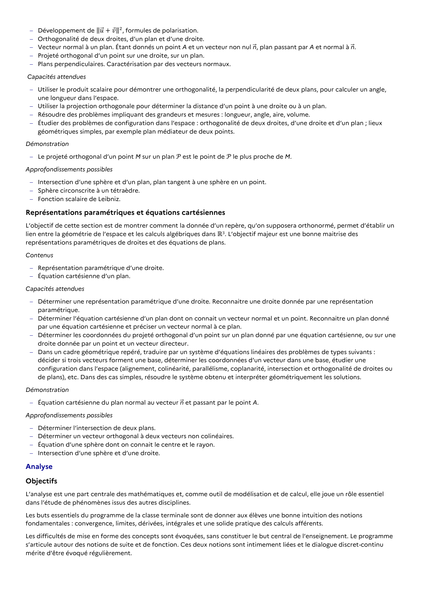

# Dans un cadre géométrique repéré, traduire par un système d’équations linéaires des problèmes de types suivants : décider si trois vecteurs forment une base, déterminer les coordonnées d’un vecteur dans une base, étudier une configuration dans l’espace (alignement, colinéarité, parallélisme, coplanarité, intersection et orthogonalité de droites ou de plans), etc. Dans des cas simples, résoudre le système obtenu et interpréter géométriquement les solutions.

## Formulation BO (citation exacte)

> Dans un cadre géométrique repéré, traduire par un système d’équations linéaires des problèmes de types suivants : décider si trois vecteurs forment une base, déterminer les coordonnées d’un vecteur dans une base, étudier une configuration dans l’espace (alignement, colinéarité, parallélisme, coplanarité, intersection et orthogonalité de droites ou de plans), etc. Dans des cas simples, résoudre le système obtenu et interpréter géométriquement les solutions.

## Source

Programme officiel : *tspe.pdf*, **BO Hebdo 14 du 2 avril 2026**, page **7**.

---

*Compétence extraite automatiquement le 2026-05-21T20:18:35+00:00. Confiance : 0.9. Statut : non vérifié.*
