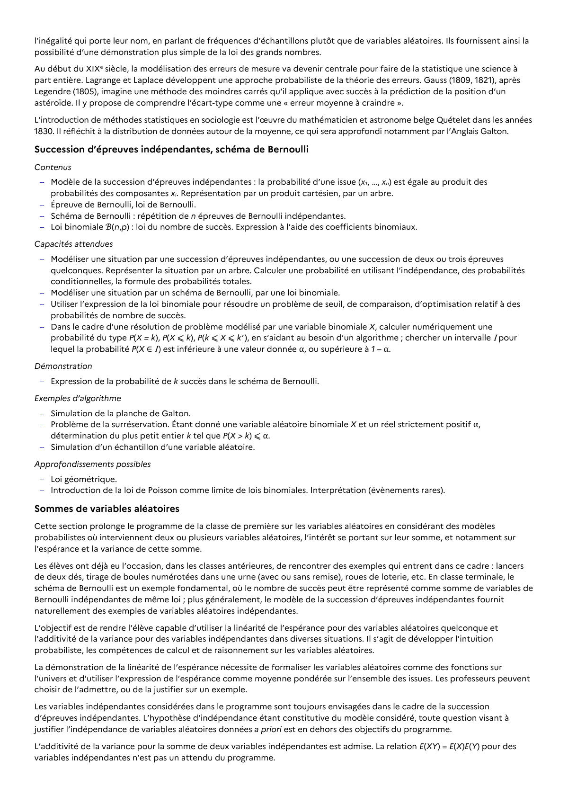

# Expression de la probabilité de k succès dans le schéma de Bernoulli.

## Formulation BO (citation exacte)

> Expression de la probabilité de k succès dans le schéma de Bernoulli.

## Démonstrations exigibles

*(corps de la démonstration à compléter)*

## Source

Programme officiel : *tspe.pdf*, **BO Hebdo 14 du 2 avril 2026**, page **13**.

---

*Compétence extraite automatiquement le 2026-05-21T20:18:35+00:00. Confiance : 0.9. Statut : non vérifié.*
