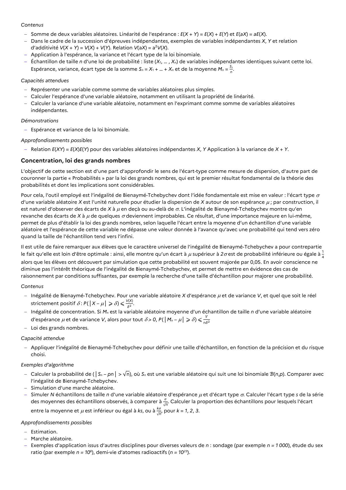

# Exemples d’application issus d’autres disciplines pour diverses valeurs de n : sondage (par exemple n = 1 000), étude du sex ratio (par exemple n = 106), demi-vie d’atomes radioactifs (n = 1023).

## Formulation BO (citation exacte)

> Exemples d’application issus d’autres disciplines pour diverses valeurs de n : sondage (par exemple n = 1 000), étude du sex ratio (par exemple n = 106), demi-vie d’atomes radioactifs (n = 1023).

## Source

Programme officiel : *tspe.pdf*, **BO Hebdo 14 du 2 avril 2026**, page **14**.

---

*Compétence extraite automatiquement le 2026-05-21T20:18:35+00:00. Confiance : 0.9. Statut : non vérifié.*
