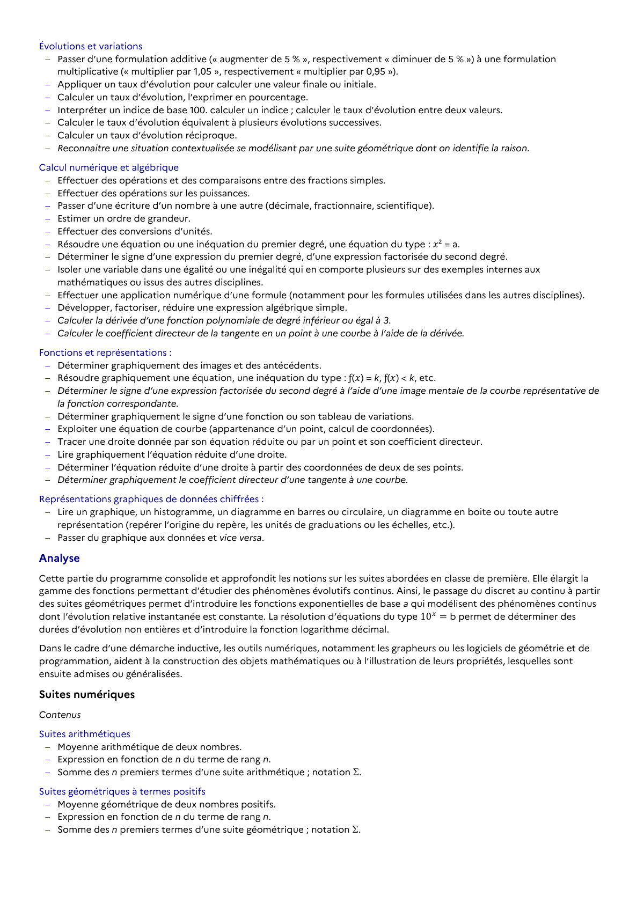

# Déterminer le signe d’une expression factorisée du second degré à l’aide d’une image mentale de la courbe représentative de la fonction correspondante.

## Formulation BO (citation exacte)

> Déterminer le signe d’une expression factorisée du second degré à l’aide d’une image mentale de la courbe représentative de la fonction correspondante.

## Source

Programme officiel : *ttec.pdf*, **BO Hebdo 14 du 2 avril 2026**, page **7**.

---

*Compétence extraite automatiquement le 2026-05-21T20:18:35+00:00. Confiance : 0.9. Statut : non vérifié.*
