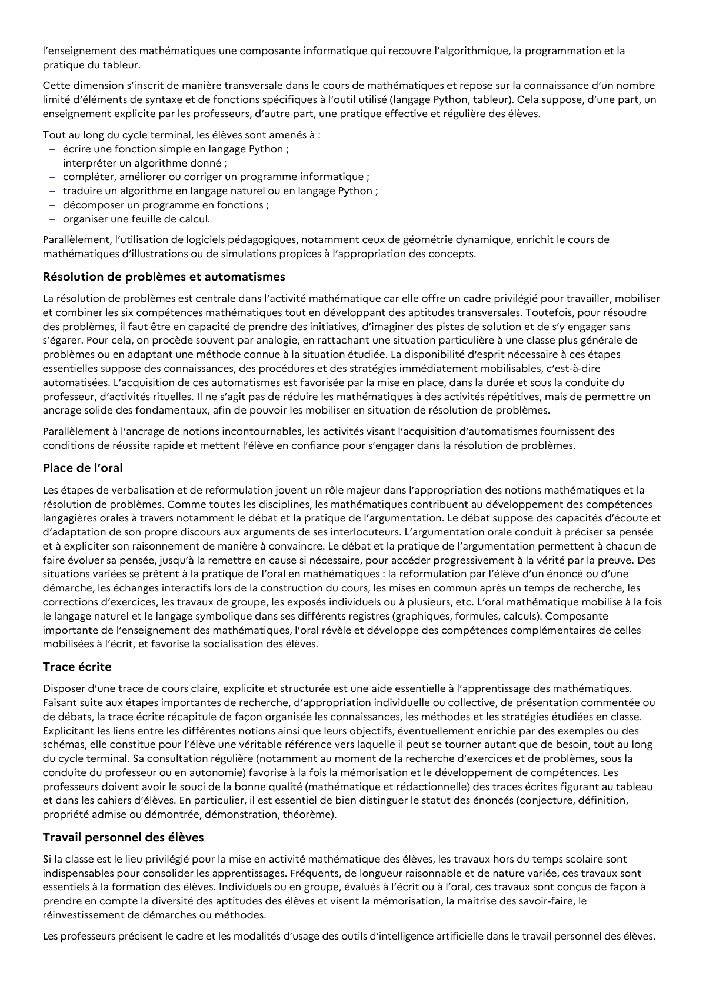

# organiser une feuille de calcul. Parallèlement, l’utilisation de logiciels pédagogiques, notamment ceux de géométrie dynamique, enrichit le cours de mathématiques d’illustrations ou de simulations propices à l’appropriation des concepts.

## Formulation BO (citation exacte)

> organiser une feuille de calcul. Parallèlement, l’utilisation de logiciels pédagogiques, notamment ceux de géométrie dynamique, enrichit le cours de mathématiques d’illustrations ou de simulations propices à l’appropriation des concepts.

## Source

Programme officiel : *ttec.pdf*, **BO Hebdo 14 du 2 avril 2026**, page **3**.

---

*Compétence extraite automatiquement le 2026-05-21T20:18:35+00:00. Confiance : 0.9. Statut : non vérifié.*
