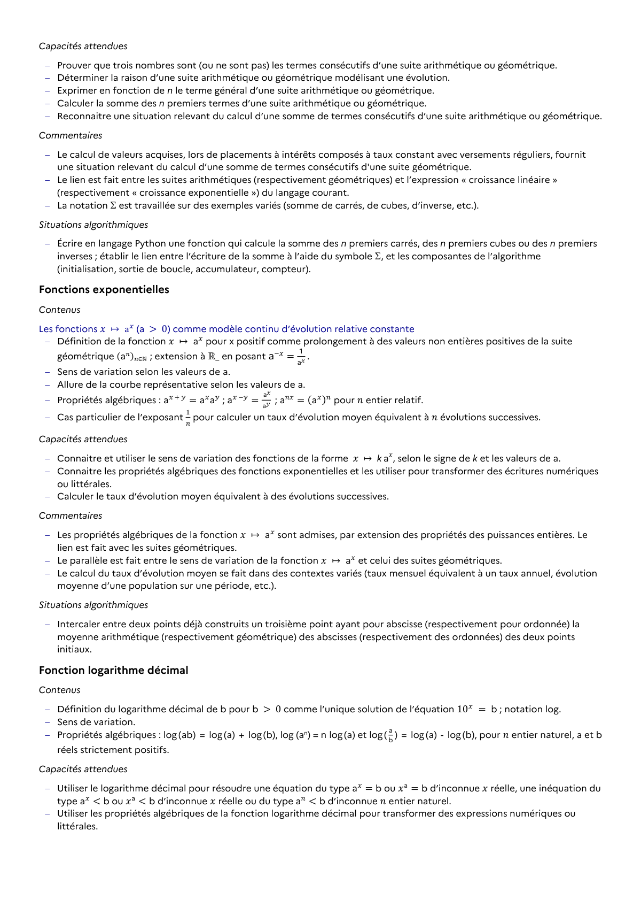

# Déterminer la raison d’une suite arithmétique ou géométrique modélisant une évolution.

## Formulation BO (citation exacte)

> Déterminer la raison d’une suite arithmétique ou géométrique modélisant une évolution.

## Source

Programme officiel : *ttec.pdf*, **BO Hebdo 14 du 2 avril 2026**, page **8**.

---

*Compétence extraite automatiquement le 2026-05-21T20:18:35+00:00. Confiance : 0.9. Statut : non vérifié.*
