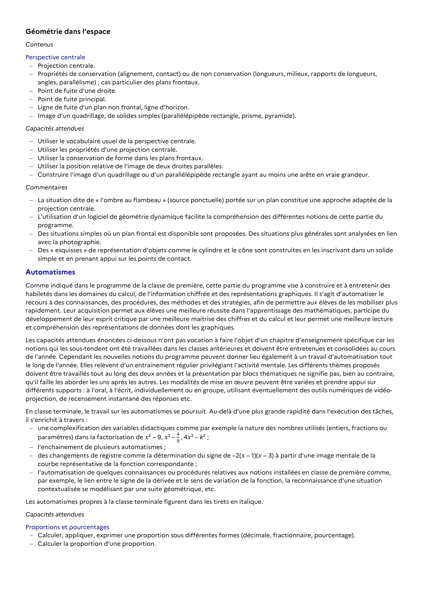

# Point de fuite principal.

## Formulation BO (citation exacte)

> Point de fuite principal.

## Source

Programme officiel : *ttec.pdf*, **BO Hebdo 14 du 2 avril 2026**, page **6**.

---

*Compétence extraite automatiquement le 2026-05-21T20:18:35+00:00. Confiance : 0.9. Statut : non vérifié.*
